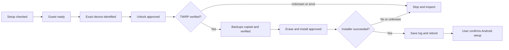

# Echo Show Mac Loader

Product and implementation proposal · October 10, 2026

**Build a small Mac app that guides someone from plugging in their Echo to completing Android setup.** The user should see a picture, one action and a checked result at each stage. Linux, translation, hashes and USB transport belong behind the interface, with details available when needed.

Start with the 2019 Echo Show 5, CHECKERS, and the exact software combination that worked here. We have one successful installation: the installer reported success, and the owner confirmed setup, Wi-Fi and the home screen. Wider device compatibility, repeatable unlocking, restoration and remaining hardware functions are unverified.

## The experience

| Screen | What the user does | What the app establishes |
| --- | --- | --- |
| **Check my setup** | Connect power and the USB cable; select the Echo if necessary. | Host compatibility, tool availability and which device is connected. |
| **Prepare your Mac** | Approve downloads and creation of a dedicated Linux environment. | Pinned downloads match; the guest starts; the original fastboot client runs and passes its offline test. |
| **Connect your Echo** | Follow button illustrations and the two USB-assignment screenshots. | The chosen Echo is visible in Linux and its product/build match the supported profile. |
| **Prepare the Echo** | Review the unlock action and continue. | Run the reviewed bounded procedure, then confirm actual TWRP recovery. An uncertain result stops here. |
| **Save your backup** | Choose a private destination on the Mac or an attached drive. | Required partitions are copied, sized and hashed successfully. Show the saved location and what the backup covers. |
| **Install Android** | Review the erase/install summary and approve it. | The selected ROM matches; installation completes successfully; the recovery log is saved before reboot. |
| **Finish setup** | Follow the Echo's setup screens; confirm the home screen and basic checks. | Distinguish installation, first boot and tested hardware functions. |

The most useful feature is a connection display with separately verified states: **Mac sees Echo → Linux sees Echo → Recovery detected**. If a stage is missing, show its next action. A USB identifier alone must not select the device for flashing.

Use measured download/copy progress and actual byte totals. Show elapsed time and an explicit waiting message when progress cannot be measured. Never turn an eight-second timeout, USB disappearance or boot animation into a completed-installation checkmark.

## First deliverable: “Check my setup”

Build a device-read-only companion first. It can inspect host versions, verify user-selected downloads, enumerate USB, and query identity through an already-configured guest. If the guest is absent, it explains the preparation step. It may save local reports; it cannot flash, erase, reboot, stage data, change the device or automatically alter the VM.

This milestone needs no repeat unlock on the working Echo. Develop against saved, sanitized output and fake command runners. Its usefulness is concrete: replace vague “device not found” messages with “visible to macOS; not assigned to Linux,” or “Linux translation has not been verified.”

Acceptance checks:

- Missing files, wrong hashes, unsupported builds, multiple devices and missing guest translation produce accurate stop messages.
- Identity parsing requires complete expected values, including under Python optimization if Python helpers remain.
- Disconnects and app restarts never claim a completed check from stale evidence.
- Exported reports omit serials, usernames, addresses, private paths and credentials by default, with a preview before saving for sharing.
- Tests prove that the command dispatcher rejects every device-writing operation in this build.

## Implementation

Use a native SwiftUI interface, a small local workflow controller and explicit adapters for UTM, the Linux guest and host ADB. Keep the first implementation local: no accounts, server or telemetry are needed.

Retain the original bundled Linux fastboot executable and its validated hash. Control an isolated UTM guest through supported scripting/CLI capabilities and an authenticated guest connection. UTM 5.0.6 documents Apple Virtualization USB scripting, but macOS still requires the initial accessory assignment. Linux guest provisioning needs a separate implementation test; UTM's documented macOS provisioning feature does not establish automated Debian provisioning. [UTM release notes](https://github.com/utmapp/UTM/releases/tag/v5.0.6).

Provision from pinned publisher downloads and a reproducible guest setup recipe. Give each local installation its own credentials or keys. Do not distribute our personal VM or assume a previous translation mount survived reboot. Verify the runtime and original client again when opening a session.

Keep a versioned compatibility manifest containing the host/guest versions, device/build values, tool and ROM hashes, publisher links and recovery requirements. New versions need explicit validation rather than silently following a `current` download URL. If a publisher download requires interaction, open that page and verify the file the user supplies.

For future compatibility, Apple's macOS-app Rosetta phaseout and Linux VM translation are distinct. Apple documents integrated Intel Linux translation in macOS 27. That supports retaining this architecture for now; it does not prove our entire workflow on future macOS or UTM releases. [Apple Linux VM documentation](https://developer.apple.com/documentation/virtualization/running-intel-binaries-in-linux-vms), [Apple Rosetta support timeline](https://support.apple.com/en-us/102527).

## Checkpoints, backups and resume

Record an operation's intent before issuing it and its observed result afterward. Bind the record to the selected device, build and tool versions. On resume, rediscover the device and recheck its mode. Never replay an unlock, wipe, install or reboot merely because the app closed before recording completion. An interrupted write goes to inspection; an interrupted backup is incomplete until copied and verified again.

Our backups became possible after TWRP was reached. They protect the pre-ROM state, **not the earlier unlock step**, and include the installed TWRP rather than factory recovery. The app must describe this accurately.

For backups, validate the actual partition mapping, require relevant filesystems to be unmounted, and check both `/data` and `/sdcard` aliases. Check destination capacity, handle disks disconnecting or filling up, use partial filenames until verification finishes, and compare source/host sizes and hashes. Preserve backup metadata locally. Never upload partition images or include them in support bundles. Restoration needs its own reviewed and tested workflow.

For unlocking, keep attempts bounded and stop on timeout, changed response, identity mismatch or lost connection. Only a specifically reviewed complete rejection may permit a retry under the chosen policy. Our successful sequence stopped after its first attempt; it does not establish that retries improve reliability.

During the approved unlock sequence, preserve the reviewed query order and timing. Suspend background polling and do not insert throughput probes. Read-only checks can still change session timing; the app must not quietly alter the sequence it claims to reproduce.

## Build order and release gates

1. **Setup checker:** read-only device access, offline fixtures, useful status messages and a sanitized report.
2. **Host preparation and backup assistant:** reproducible guest setup; verify it from a clean host account. Validate backup handling on test fixtures and an already-authorized recovery device without erasing it.
3. **Supervised installer:** reviewed command helpers, explicit unlock and erase confirmations, log capture, interruption tests and independent reproduction on another supported unit. Keep it experimental until its limits are measured.

Capture two annotated USB screenshots for the tested OS/UTM versions: the macOS accessory menu assigning Android to UTM, then UTM assigning it to the intended guest. Also capture the Echo button positions, TWRP confirmation and Android setup's **Update Lineage Recovery** option. Use clean accounts or redact personal information. These assets are planned, not captured for this proposal.

The public repository's front page should remain a short walkthrough. Keep the compatibility manifest, tests and developer notes nearby, but outside the ordinary user's path. Preserve upstream credits and review redistribution rights before bundling anyone else's executable, payload or ROM.

This is a design proposal, not an implemented loader. It aims to remove the host setup and decision-making burden while preserving honest limits around the device-writing steps.
